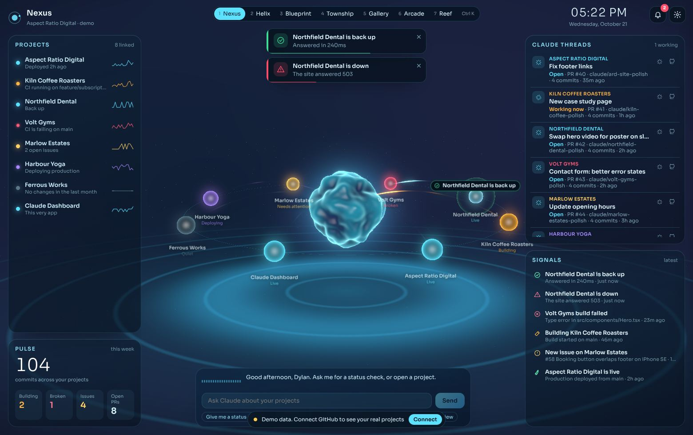
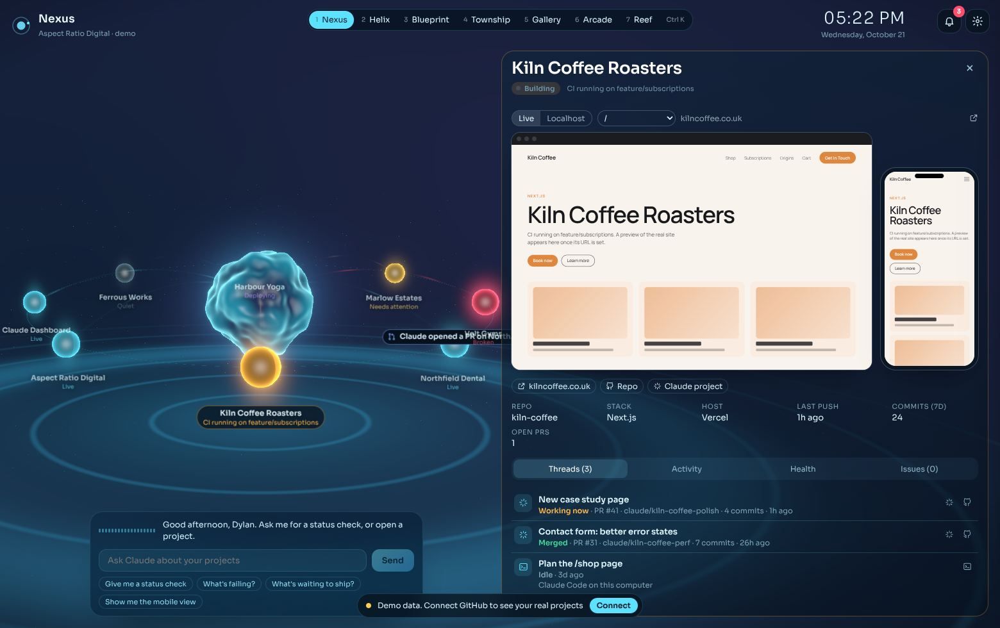
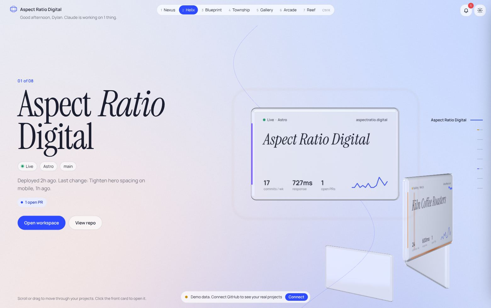
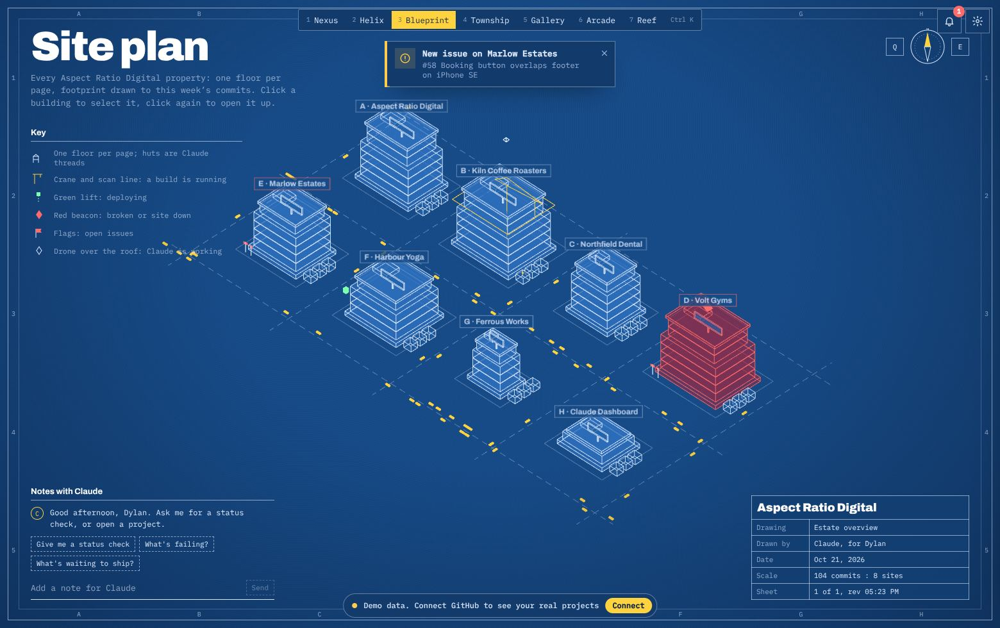
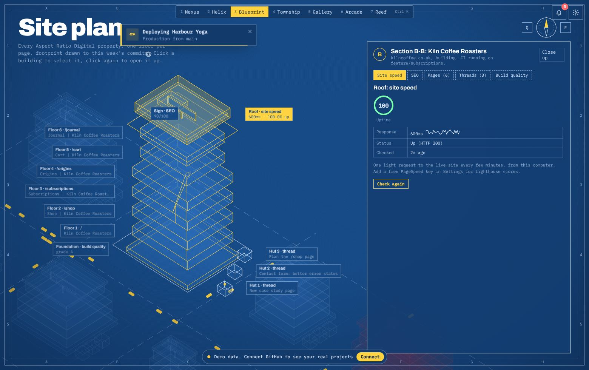
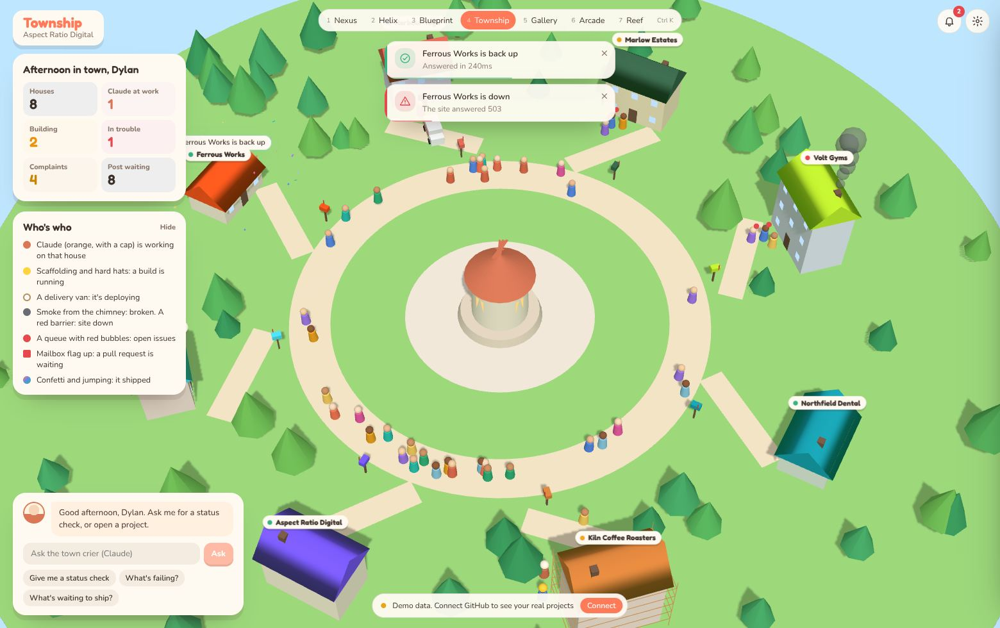
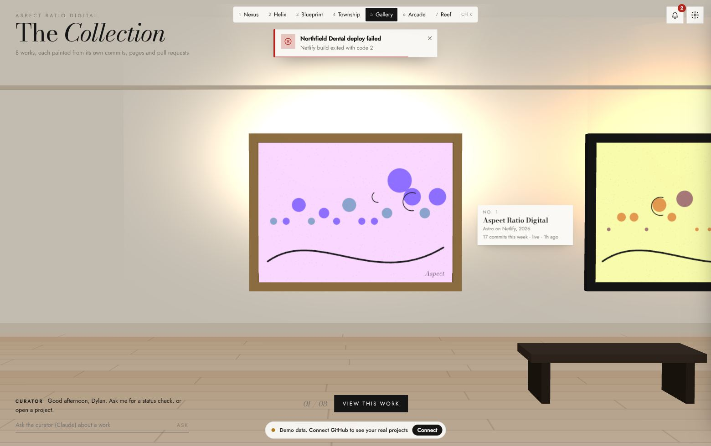
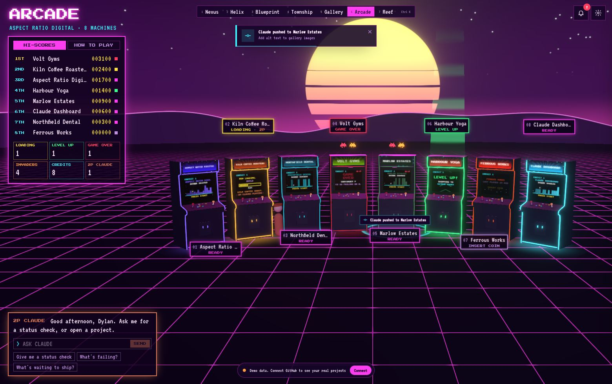
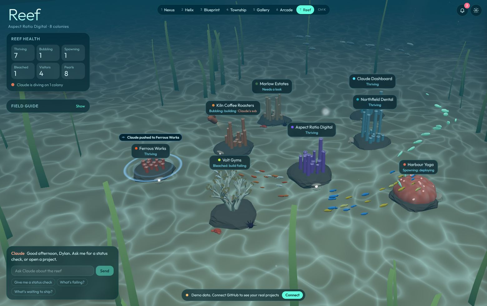
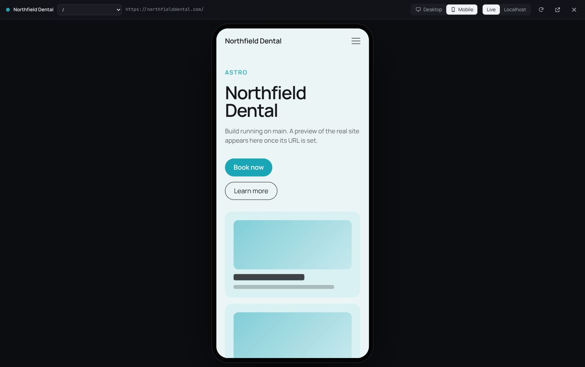

# Claude Dashboard

A 3D command centre for Aspect Ratio Digital. Every site you're building with Claude, pulled live from GitHub, shown in seven dashboards you can flip between. Each one has notifications built into the scene: builds, deploys, failures, issues, pull requests and Claude at work. Click any project to see its desktop and mobile previews side by side, then click either one to open the site fullscreen.

It runs on your own computer, in your browser or as a desktop window.



## Run it

You need [Node.js 20 or newer](https://nodejs.org) (22 LTS recommended) and Git.

If you already have the folder (for example `D:\Claude-Dashboard`), open a terminal there and run:

```powershell
cd D:\Claude-Dashboard
git fetch origin
git checkout claude/project-thread-35jdu8
git pull
npm install
npm run dev
```

Then open **http://localhost:5173**. Once this branch is merged you can use `git checkout main` and `git pull` instead.

Starting from scratch:

```bash
git clone https://github.com/aspectratiodigital/Claude-Dashboard.git
cd Claude-Dashboard
npm install
npm run dev
```

| Command | What it does |
| --- | --- |
| `npm run dev` | Dashboard in your browser at http://localhost:5173, with the local data service built in |
| `npm run app` | The same thing in its own desktop window (Electron) |
| `npm start` | Builds once and serves the build, closest to the finished experience |
| `npm run build` | Type-checks and builds into `dist/` |

## Connect your projects

The first time it opens you'll see demo projects and a banner. Click **Connect** (or the gear icon) to open Settings.

1. **GitHub.** Either click **Create a read-only GitHub token**, which opens GitHub with the right read-only permissions already ticked, and paste the token in; or, if you use the GitHub CLI, run `gh auth login` once and the dashboard picks it up by itself.
2. **Projects.** Every repo under `aspectratiodigital` shows up. The live URL, preview URL and framework are found from each repo's website field and its deploys. You can override any of them, set a `localhost` port for your dev server, or hide a repo.
3. **PageSpeed (optional).** Paste a free Google PageSpeed Insights key if you want Lighthouse scores. Without one, the dashboard still checks each live site every few minutes for free: whether it's up, how fast it answers, and its basic SEO tags.

Your token and keys are saved in `.jarvis/settings.json` on your computer only. That folder is ignored by Git, and the token is only ever sent to GitHub. To limit which repos appear, list them in `include` (or `exclude`) in [`jarvis.config.json`](jarvis.config.json).

### How it finds your Claude projects

claude.ai doesn't offer an API for Projects yet, so the dashboard can't read your project list from claude.ai directly. Instead it treats each GitHub repo you work in as a project and spots Claude's work on it from:

- branches Claude creates (`claude/...`)
- pull requests that link back to a claude.ai session or project (that link becomes the project's **Claude project** button)
- `Claude-Session:` and `Co-Authored-By: Claude` lines in commits
- Claude Code sessions on this computer, from `~/.claude/projects`. Only the session title, folder, branch and times are read, never the conversation.

So the projects on screen are the real sites you're working on with Claude, and each thread links back to where it lives.

## The seven dashboards

Press `1` to `7` to switch. Your choice is remembered.

### 1. Nexus

A liquid Claude core with your projects orbiting as glowing droplets, joined to it by ribbons of light. Rebuilt so it no longer flickers or flashes: everything is soft-edged and eased. Amber sparks circle a project while it builds, a violet stream rises while it deploys, small satellites orbit for open issues, a broken project glows red with a slow heartbeat, and pulses of light run out along the ribbon while Claude works on it. Any event sends a soft shockwave from the droplet. Click one to open its previews and threads.



### 2. Helix

Glass cards on a spiral you scroll, drag or arrow through. Each card is drawn from the live project: a striped progress bar while it builds or deploys, a red glow when broken, three bouncing dots when Claude is working. Open one for its previews, threads, activity, health and issues.



### 3. Blueprint

Your sites as an isometric city on a drafting sheet. One floor per page, footprint from this week's commits. Cranes and a scan line while it builds, a green lift while it deploys, a drone when Claude's on it, a red beacon when broken, flags for issues.

Click a building to select it. Click it again (or press `Enter`) to **open it up**: it separates into a cross-section you can click through, with the roof for site speed, the sign for SEO, a floor for each page, the foundation for build quality, and huts for Claude's threads.




### 4. Township

A little town where every project is a house and peg people walk the paths between them. Scaffolding and hard hats while it builds, a delivery van while it deploys, chimney smoke when it's broken, a barrier when the site is down, a queue of unhappy visitors for issues, the mailbox flag up for pull requests, and Claude in orange with a cap when Claude's working there. When something ships, confetti goes up and the townsfolk jump.



### 5. Gallery

A quiet museum where each project is a painting generated from its own commits, pages and pull requests. The spotlight turns amber and sweeps while it builds, a drape covers it while it deploys and lifts when the deploy lands, a velvet rope goes up when it's broken, notes get pinned beside it for issues, and Claude stands at an easel when working on it.



### 6. Arcade

A neon arcade where every site is a cabinet. The screen plays the project's state: attract mode with a skyline of the last 14 days, NOW LOADING, LEVEL UP while it deploys (with a green beam), GAME OVER when it fails (a slow pulse, never a flash), an OUT OF ORDER sign when the site is down, NEW HIGH SCORE after a deploy. Space invaders hover over sites with issues, coins stack up for pull requests, Claude stands in as player 2, fireworks go up when something ships, and the marquee lights race when anything happens. The high-score table on the left doubles as your project list.



### 7. Reef

A sunlit seabed where every project grows its own coral: branching coral from its pages, brain coral from its commits, tube coral from the last 14 days. Bubbles rise while it builds, a school of fish spirals up while it deploys, the coral bleaches when it breaks and silts up when the site is down, crabs (and spiky urchins for bugs) gather for issues, clams hold pearls for pull requests, a pink jellyfish and a plankton bloom follow a deploy, and Claude's orange submarine circles while Claude works.



## Previews

Every dashboard opens a project the same way: a large desktop preview and a phone preview side by side, a page picker, and a switch between the live site and your `localhost` dev server. Click either preview to open it fullscreen at that size, then flip between desktop and mobile, change page, reload or pop it out to your browser.



## Notifications

Changes are spotted as the data refreshes (about once a minute) and appear in three places at once: a toast at the top, the bell's history drawer (press `N`), and an effect on that project in whichever dashboard you're in. The drawer has a **Preview a notification** panel so you can fire any kind on any project and see how each dashboard shows it.

The kinds: build started, passed or failed; deploying, deployed or deploy failed; new issue; pull request opened, review requested or merged; push; Claude started working; site down or back up; site slower than usual.

## Controls

| Key | Action |
| --- | --- |
| `1` to `7` | Switch dashboard |
| `Ctrl K` | Command palette: jump to any project or dashboard |
| `N` | Notifications |
| `Esc` | Close the fullscreen preview, then the open project |
| `F` | Frame-rate meter |
| `←` `→` | Move between projects in Helix, Gallery and Arcade |
| `Enter` | Open the current project (Helix, Gallery); open up a building (Blueprint) |
| `Q` `E` | Rotate the Blueprint plan |
| Drag, scroll | Look around and zoom in Blueprint, Township, Arcade and Reef |

## Laptop friendly

Settings has a **Quality** choice. **Auto** reads your graphics chip once: a dedicated GPU gets **High**, and integrated graphics (most laptops, including the MateBook) get **Balanced**. On battery it drops a level by itself.

- **High:** full resolution, glow and smoothing, shadows in Township, richer water in Reef.
- **Balanced:** resolution capped, glow drawn at reduced size, no blur behind panels (the most expensive effect on integrated graphics), simpler materials.
- **Battery saver:** no glow, lower resolution, the lightest version of every scene.

On every level the scene pauses completely while a fullscreen preview is open, drops to 30 frames a second after 20 seconds without input (except Township, where people are walking), and steps resolution down if frames start slipping. Press `F` to see the frame rate.

## How it's built

- **Vite + React 19 + TypeScript**, each dashboard code-split and preloaded in the background so switching is instant.
- **three.js through React Three Fiber**, with custom shaders for the Nexus core, the Arcade floor and sky, the Reef caustics and more. Labels are plain DOM positioned from the scene, which keeps them sharp and cheap.
- **A small local service** runs inside the dev server ([`server/`](server)). It polls GitHub with ETag caching (so it barely touches your rate limit), reads local Claude Code sessions, checks your live sites, turns changes into notifications, and streams everything to the page.
- **Electron** for the optional desktop window ([`electron/main.cjs`](electron/main.cjs)).

```
server/                  local data service: GitHub, Claude sessions, site checks, notifications
src/data/                the data contract, live store, and the demo projects
src/shared/              scene canvas and quality tiers, previews, notifications, project panel
src/concepts/nexus/      Nexus
src/concepts/helix/      Helix
src/concepts/blueprint/  Blueprint
src/concepts/township/   Township
src/concepts/gallery/    Gallery
src/concepts/arcade/     Arcade
src/concepts/reef/       Reef
```
