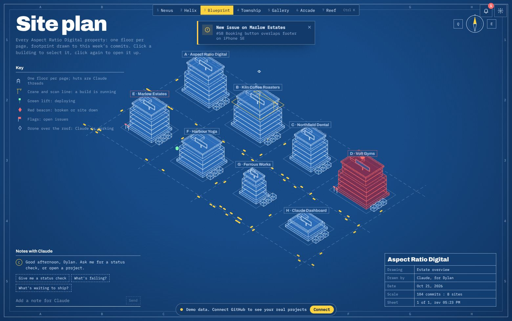
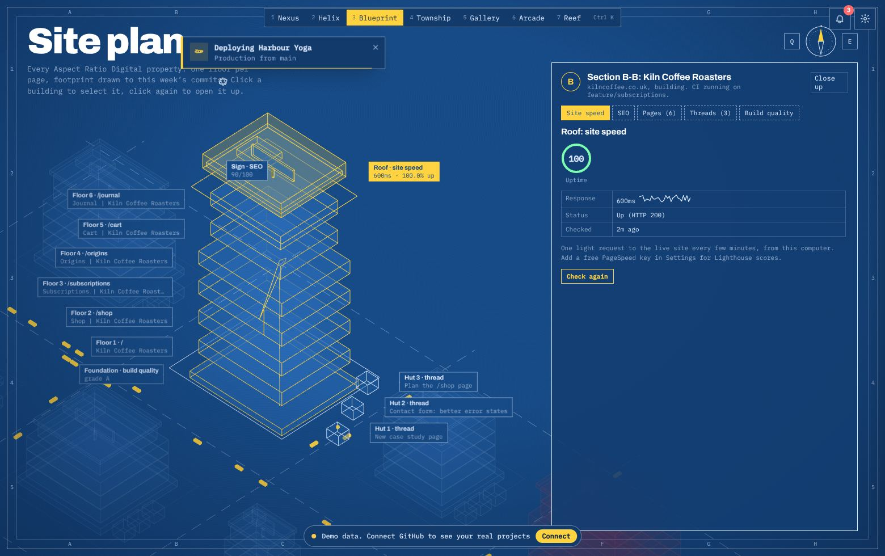
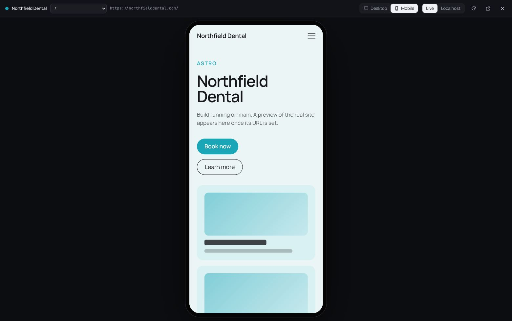

# Blueprint

A 3D command centre for Aspect Ratio Digital. Every site you're building with Claude, pulled live from GitHub and drawn as an isometric city on a drafting sheet: one building per project, one floor per page. Builds, deploys, failures, issues, pull requests and Claude at work all show up on the buildings themselves. Click a building to select it, click again to open it up, and open any site's desktop and mobile previews fullscreen.

It installs as a desktop app on Windows, or runs in your browser.



## Install the desktop app

You need [Node.js 20 or newer](https://nodejs.org) (22 LTS recommended) and Git, just once, to build the installer. In a terminal:

```powershell
cd D:\Claude-Dashboard
git fetch origin
git checkout main
git pull
npm install
npm run dist
```

That makes `release\ARD Blueprint Setup 0.1.0.exe`. Double-click it, click through the installer, and you get **ARD Blueprint** on your desktop and in the Start menu. Pin it to the taskbar if you like. The app has the data service built in, so nothing else needs to be running.

If PowerShell says `npm.ps1 cannot be loaded because running scripts is disabled`, type `npm.cmd` instead of `npm` (for example `npm.cmd run dist`), or run `Set-ExecutionPolicy -Scope CurrentUser RemoteSigned` once and open a new window.

Windows may show "Windows protected your PC" the first time, because the installer isn't code-signed. Click **More info**, then **Run anyway**.

**It updates itself.** Each time it opens, the app checks the folder it was built from (here `D:\Claude-Dashboard`) for new changes on GitHub. If there are any, it pulls them and rebuilds in the background while you keep working, then offers **Restart now** or installs quietly when you next close it. Your settings are kept, and the log is in `%APPDATA%\ARD Blueprint\update.log`. If you ever want to force it, double-click **Update Blueprint.cmd** in the same folder.

The app keeps its settings, GitHub token and notifications in `%APPDATA%\ARD Blueprint\data`, separate from the `.jarvis` folder the browser version uses, so connect GitHub once inside the app.

### On another Windows PC

Each computer builds its own copy. On a fresh PC, in PowerShell:

```powershell
winget install OpenJS.NodeJS.LTS Git.Git
```

Close PowerShell and open a new one so it finds them, then:

```powershell
cd D:\
git clone https://github.com/aspectratiodigital/Claude-Dashboard.git
cd Claude-Dashboard
npm.cmd ci
npm.cmd run dist
start "release\ARD Blueprint Setup 0.1.0.exe"
```

The repo is private, so the first `git clone` opens a GitHub sign-in window. Once the app opens, connect GitHub in Settings, and set up the Claude bar (below) on that PC too. It then updates itself from that folder like the first one.

The app updates from whichever branch its folder has checked out, which should be `main`. To check, run `git branch --show-current` in the folder.

## Run it in the browser

For working on the dashboard itself, from `D:\Claude-Dashboard`:

```powershell
cd D:\Claude-Dashboard
git fetch origin
git checkout main
git pull
npm install
npm run dev
```

Then open **http://localhost:5173**. Once this branch is merged you can use `git checkout main` and `git pull` instead.

Starting from scratch:

```bash
git clone https://github.com/aspectratiodigital/Claude-Dashboard.git
cd Claude-Dashboard
npm install
npm run dev
```

| Command | What it does |
| --- | --- |
| `npm run dev` | Dashboard in your browser at http://localhost:5173, with the local data service built in |
| `npm run app` | The same thing in its own desktop window (Electron), with live reload |
| `npm run app:prod` | Builds and opens the desktop app exactly as installed, without making an installer |
| `npm run dist` | Builds the Windows installer into `release/` |
| `npm run build` | Type-checks and builds into `dist/` and `dist-electron/` |

## Connect your projects

The first time it opens you'll see demo projects and a banner. Click **Connect** (or the gear icon) to open Settings.

1. **GitHub.** Either click **Create a read-only GitHub token**, which opens GitHub with the right read-only permissions already ticked, and paste the token in; or, if you use the GitHub CLI, run `gh auth login` once and the dashboard picks it up by itself.
2. **Projects.** Every repo under `aspectratiodigital` shows up. The live URL, preview URL and framework are found from each repo's website field and its deploys. You can override any of them, set a `localhost` port for your dev server, or hide a repo.
3. **PageSpeed (optional).** Paste a free Google PageSpeed Insights key if you want Lighthouse scores. Without one, the dashboard still checks each live site every few minutes for free: whether it's up, how fast it answers, and its basic SEO tags.

Your token and keys are saved in `.jarvis/settings.json` on your computer only. That folder is ignored by Git, and the token is only ever sent to GitHub. To limit which repos appear, list them in `include` (or `exclude`) in [`jarvis.config.json`](jarvis.config.json).

### How it finds your Claude projects

claude.ai doesn't offer an API for Projects yet, so the dashboard can't read your project list from claude.ai directly. Instead it treats each GitHub repo you work in as a project and spots Claude's work on it from:

- branches Claude creates (`claude/...`)
- pull requests that link back to a claude.ai session or project (that link becomes the project's **Claude project** button)
- `Claude-Session:` and `Co-Authored-By: Claude` lines in commits
- Claude Code sessions on this computer, from `~/.claude/projects`. Only the session title, folder, branch and times are read, never the conversation.

So the projects on screen are the real sites you're working on with Claude, and each thread links back to where it lives.

## What's on the plan

One building per site. Its footprint grows with this week's commits and it has one floor per page.

| You see | It means |
| --- | --- |
| Cranes and a scan line | A build is running |
| A green lift | It's deploying |
| A red beacon, the building turns red | A build or deploy failed, or the site is down |
| Flags | Open issues |
| A drone over the roof | Claude is working on it |
| A ring spreading from the building | Something just happened |
| A shopfront on the side | The site's Shopify store (a coin rises on each new order) |

Click a building to select it. Click it again (or press `Enter`) to **open it up**: it separates into a cross-section you can click through, with the roof for site speed, the sign for SEO, a floor for each page, the foundation for build quality, and huts for Claude's threads.

The huts are stacked newest push first, so the top one (labelled **Latest push**) is the most recent work on that site. Click a hut to see **What changed**: a short plain-English description of what that push does to the site, written by your Claude Code (with its quickest model) the first time you open it and kept after that. Without Claude Code it shows the pull request's own summary instead.

**Themes:** Settings, then **Appearance**, switches between Blueprint, Light (off-white with near-black lines) and Dark (off-black with soft white lines). In the desktop app the window's title bar follows: white on Light, black on Dark, and Windows' own colour on Blueprint.

### Apps

Each building's details have a **Type** switch: **Website** or **App**. A repo with an Expo / React Native, Capacitor or Flutter app in it starts as an app; anything else starts as a website. An app's floors are its **home screen** (floor 1) and then one floor per **game mode**, instead of one per page. Open the building and pick a floor to see what's on it as pictures:

- **App skins:** the home screen in each skin, screenshotted from the live web build (`?skin=` links), and on each game's floor that game in every skin (`?game=…&skin=…`).
- **Card skins:** each deck's back and its full sheet of faces.
- **Other images:** the textures, labels and icons in the app's assets folder.

Click any of them to see it full screen. Use the arrows (or `←` `→`) to go through the rest, **Open it live** to play with the real screen, and `Esc` to close.

It's read from the code on GitHub each time the default branch moves: a `games` / `modes` file (`{ id, title, tagline }` entries) gives the floors, a `skins` / `themes` file the skins, and a `packs` / `decks` file the card designs, matched to images by name. An app laid out differently can describe its floors in a `blueprint.app.json` instead (`{ "floors": [{ "name", "galleries": [{ "name", "items": [{ "name", "images": [{ "path" }] }] }] }] }`). Screenshots need the app's web address (Settings, or the repo's website). The desktop app takes them itself; in the browser version they use Edge or Chrome on this computer.



The other six dashboards (Nexus, Helix, Township, Gallery, Arcade, Reef) were retired. Their code is in this repository's history at commit `f6032d0`, and `git checkout f6032d0` brings them back.

### Shopify stores

A site built on Shopify gets a shopfront on the side of its building. The dashboard spots it in the code: Hydrogen, the Storefront API or the Buy SDK in `package.json` (a headless store), or a Liquid theme's folders. The store's address comes from `.env.example` (any `xxx.myshopify.com` in it). If the code doesn't name it, or the site isn't detected, use **Attach a Shopify store** in the building's details.

Open the building and click the shopfront (or the **Store** tab) for today's orders and sales, the last 7 days, recent orders and anything under 5 in stock, each linking to the Shopify admin. New orders and low stock also arrive as notifications, and Claude knows each store's numbers when you ask about it.

To see the numbers, connect the store once, from the **Store** tab:

- **Dev Dashboard app (new stores):** in the [Shopify Dev Dashboard](https://dev.shopify.com/dashboard), create an app, give its version the `read_orders`, `read_products` and `read_inventory` scopes, install it on the store, and paste its **Client ID** and **Client secret**. This works for stores in your own Shopify organisation.
- **Admin API token (older stores):** if a store already has a custom app made in its admin, paste its `shpat_…` token instead. Shopify no longer lets you create new ones there.

Either is kept in this computer's settings only. It isn't synced to your other computer, shown in the browser or passed to Claude. Once connected, a store stays connected on that computer: closing and reopening the app shows its last numbers straight away and refreshes them within a few seconds. The dashboard checks each connected store every 2 minutes.

## Claude bar

The **Notes with Claude** panel runs your own Claude Code, signed in with your Claude account, so there's no API key or extra billing. Pick a project in **About**, or click its building, and Claude works in that project's folder on this computer. It finds the folder from where you last used Claude Code on that repo, or from **Folder** if you've set one for that project in Settings. With **All projects** it answers from the live state of every site.

By default Claude runs in **Auto**, the same as Claude on the web: it gets on with reading, editing files and running commands (builds, tests, git, scripts in the console) without asking, and only stops for an **Allow** when something looks risky, such as deleting a lot of files or pushing somewhere it shouldn't.

- **GitHub:** Claude gets the same GitHub access as the dashboard, so it can read pull requests, issues and Actions logs, and push and open pull requests the way Claude on the web does. Code changes go on a branch with a pull request, and it merges only when you say. It uses the GitHub CLI when that's installed (`winget install GitHub.cli`, then `gh auth login`), or the token in Settings otherwise. For Claude to push and open pull requests with the token, use **create a read-and-write token** in Settings instead of the read-only one. A project that isn't on this computer yet gets cloned into Claude's workspace folder the first time Claude needs its code, and is used from then on.
- **Model, effort and permissions:** pick them under the message box. **Default** uses whatever Claude Code is set to on this computer. **Permissions** is **Auto** (above), **Ask first** (Allow for every edit and command), **Allow edits** (edits go ahead, commands ask) or **Allow everything** (never asks). If this computer's Claude Code is too old for Auto it quietly uses Allow edits, so run `claude update` to get Auto. The choices are remembered and synced.
- **While it works** there's one line at the bottom of its reply, with a tiny crane moving a block back and forth, saying what it's doing right now ("Reading orders.ts", "Running the build"); it's replaced by the next thing and goes when Claude's finished. For bigger jobs Claude sets out its plan as a **Tasks** checklist that ticks off as it goes and disappears once it's done. What it said along the way folds into a **Worked through N steps** line under the answer.
- **Allow** boxes go away once you've answered them.
- **In a building:** select a building and click **Open Claude**. Its details panel turns into Claude for that project, with every conversation you've had about it since the app opened. **Details** (or `Esc`) goes back.
- **Fullscreen:** the expand button on the notes panel, or **Open fullscreen** in a building's Claude panel, opens a full Claude workspace: your projects down the left, that project's threads in the middle, and the conversation on the right. Start as many threads as you like with **+ New thread**; each one runs on its own, so Claude can work on several things at once. `Esc` closes it.

Conversations are kept between launches (in the app's data folder, newest 300), and each one picks up its Claude Code session again, so Claude remembers what you discussed. Delete a thread with the ✕ next to it in fullscreen, and search them from the box above the list.

- **Files in:** click the paperclip, drop files on the message box, or paste a screenshot. They're saved in the app's data folder (not your project, so they never end up in a commit) and Claude reads them with the message. Up to 25 MB each.
- **Files out:** every file Claude writes or edits shows under its reply with **Open**, **Show in folder** and **Download**, and images get a preview. Ask for a document, an export or an image and it lands in the project's folder (or Claude's workspace folder with **All projects**). Programs and scripts only get **Show in folder**, never **Open**.
- **Replies** are formatted (lists, tables, code). Hover one for **Copy**, and **Retry** asks again for the last reply.
- **Instructions & files** (fullscreen, top right) works like a Claude project: instructions Claude follows in every thread about that site, plus files it can read, such as a brand guide or price list. With **All projects** selected they're your instructions for everything. They live in the sync folder when you've set one, so both computers share them.
- **Skills & tools** (fullscreen) lists the skills, plugins, slash commands and MCP servers your Claude Code already has, including skills synced from your Claude account and ones in a project's `.claude` folder. Claude uses skills by itself when they fit. To use one on purpose, type `/` in the message box and pick it, or click it in the list. It also offers to add the Shopify Dev MCP, which gives Claude Shopify's docs and API schemas for Hydrogen work.
- **Replies** read like Claude on claude.ai: the answer first, then bullets, short sections with a line between subjects, links to the pull requests, issues and pages it mentions, and a **Your call** list when you need to decide something. Code Claude edits shows as one **Changed N files** line you can open up; documents, images and exports it makes get their own card with Open and Download.
- **Threads** are named by Claude in a few words after its first reply, and sorted into **Working**, **Waiting on you** (a question, a decision or an Allow), **Idle** and **Resolved** (folded away). Claude marks a thread resolved when the work's done, or use **✓ Resolve** / **Reopen** at the top; writing in a resolved thread opens it again.
- **Add a skill** from the same drawer: **Upload a skill** takes a `SKILL.md`, or a `.zip` / `.skill` with a skill folder in it (the kind you download from claude.ai), and **Write one** makes a new skill from a name, when to use it, and its instructions. Pick **All my projects** (saved in `~/.claude/skills`) or **This project only** (saved in the project's `.claude/skills`, so it goes in the repo). The ✕ next to one of your skills removes it.

### Laptop and PC sharing the same chats

In **Settings → Sync between computers**, click **Use OneDrive** on each computer (or type any folder both computers can see). From then on they share Claude threads, the theme, model, effort and permissions, and site links, checking for changes every 15 seconds. Your GitHub token and each project's folder stay on their own computer. Each thread is its own small file in that folder, so it uses well under a megabyte.

When you carry on a thread that was last used on the other computer, Claude Code there can't see that session, so the app hands Claude the earlier conversation as text and it picks up from there.

To set it up once, in PowerShell:

```powershell
npm.cmd install -g @anthropic-ai/claude-code
claude.cmd
```

Sign in when asked, then close and reopen the dashboard. The panel's corner reads **Claude Code** when it's connected. If `claude` lives somewhere unusual, add `"claudePath": "C:\\path\\to\\claude.exe"` to the settings file.

## Previews

Open a project and you get a large desktop preview and a phone preview side by side, a page picker, and a switch between the live site and your `localhost` dev server. Click either preview to open it fullscreen at that size, then flip between desktop and mobile, change page, reload or pop it out to your browser.



## Studio

**Studio** is the visual site builder. Open it from a building's details (**Edit in Studio**) or the command palette (`Ctrl K`, then a site's name and "edit in Studio").

- **Every website, from its latest commit.** Studio keeps its own copy of each site's repo in the app's data folder (`studio/`), separate from your working folders, and pulls the latest from the default branch each time you open a site (or **Tools → Get the latest from GitHub**). The line under the toolbar says which commit you're looking at.
- **How each site runs:** plain HTML sites (Aspect Ratio Digital, BAU Drinks) are served as they are. Sites built from data files (Kings Hill Dental, Optisoul, Diplomats of Sound) run their own build script first. Astro sites (Chai Wallahs, Grassroots Rising) install their packages the first time (a minute or two) and then run Astro's dev server, which Studio stops again after 20 minutes unused. Shopify themes (Babiators) open the live shop instead for now, and apps aren't listed. Opening a site again is quick: Studio keeps the last build and only rebuilds what changed.

### The toolbar

Site and page pickers, the address, then **screen sizes**: Mobile (390 × 844), Tablet (820 × 1180), Laptop (1440 × 900), Full width, or a size menu for **Custom** sizes and ratios like `16:9`, turning sideways, zoom, and a second size side by side. Then **Browse** (`H`, use the site normally) and **Edit** (`V`), undo and redo, and three menus:

- **View:** snap to line up, a layout grid, rulers. Hold `Alt` over the page to measure from the selection to anything else.
- **Tools:** find and replace (`Ctrl F`), preview on your phone, a screenshot for a client, open the preview in your browser, get the latest from GitHub, and **All sites**.
- **Layers:** everything on the page as a folding list, to select what's hard to click (something underneath, or hidden at this size) and to **lock** parts so they can't be changed or moved by accident.

### Element tab: what's selected

Click anything to select it (`Shift` adds more; one set of changes then applies to all of them). The panel shows only what fits what you picked, in folding sections:

- **Content:** double-click text to edit it with **bold**, *italic* and links (`Ctrl B`, `Ctrl I`, `Ctrl K`) and UK English spell check; **Edit everywhere** changes the same words on every page. Buttons get their words, where they go, a new-tab switch and a **Style** dropdown of the site's own button styles. Lists, FAQs and cards get add, duplicate, move and remove for their items; tables get rows and columns; forms get their fields and the thank-you message.
- **Photo / Video / Background:** replace from your computer (or drop a file straight onto the page), from **the site's own photos** (files already in the repo, so they add nothing to its size), or from **free stock photos** (Openverse, plus Unsplash and Pexels with keys in Settings). **Crop and adjust** (ratios, straighten, brightness, contrast, warmth), a **focal point** for cropped photos, alt text (or **Write it from the photo**, where Claude looks at it), SVG logos and icons that can match the colour around them, video files and YouTube, Vimeo or Maps embeds, galleries and carousels.
- **Design:** **Applies to** picks every screen size or just this one (the site's own breakpoints, with a badge on each change that's limited to some sizes). Text size and weight, alignment, the site's brand colours as swatches (plus any colour), spacing from the site's own scale, columns (2, 3 or 4), and an animation switch.
- **Arrange:** move earlier or later, duplicate, copy and paste (also to another page: `Ctrl C`, `Ctrl V`), hide at this size, remove. Drag to move, snapping to its neighbours; arrow keys nudge.
- **Details:** what it is, its place on the page, and lock.

### Site tab: the whole site

- **Theme:** the site's design tokens (CSS custom properties: colours, fonts, sizes), changed once for every page.
- **Content:** the site's copy and data files (JSON, YAML, Markdown front matter) as forms, so a price list or a team bio is a form field, not a hunt through the page.
- **Photos:** every photo in the repo with where it's used, a detail view, and the **unused** ones to delete in one go.
- **Find:** search this page or every page, and replace (capitals follow each match unless **Match case** is on).

### Checks tab

- **SEO:** the Google result and share card previews, title, description and share image to edit, a **target phrase** checked against the page, a **share image maker**, and the page's checks (headings, alt text, photo sizes, links, structured data, sitemap and robots.txt). **Check every page** runs them across the site.
- **Access:** an axe accessibility check (WCAG 2.2 AA) of the page with your edits, each problem with **Show where** and **Ask Claude to fix**.
- **Speed:** PageSpeed Insights for the live page, phone and computer (a free Google key in Settings avoids its rate limit).
- **Local:** the business name, phone and address checked across every page and against the structured data.
- **Traffic:** Search Console (searches, clicks, positions) and GA4 (visitors, top pages), once a Google service account is added in Settings.
- The **weekly check** (under SEO) checks every live site once a week and says what slipped since the last one.

### Publish tab

- **Your edits:** every change waiting on the canvas in plain words, with the screen sizes it applies to (and **Every size** to widen one). Click one to see it. **Save** writes them into the site's real files, never the built HTML: simple text, links and alt text go straight in, and everything else goes to Claude Code, run in Studio's copy with file tools only, told how that site is built and to follow its CLAUDE.md.
- **Go live:** **Review & push live** opens the review: the changes and the code diff, **before and after** screenshots of each changed page (phone or laptop), and **checks before going live** (nothing secret or placeholder text in the changes, file sizes, every changed page opens, its search details, and its links). Then **Push live** (one commit to the default branch), **Save as draft** (a `studio/...` branch and a pull request link), **Later** (book a time; it runs while Blueprint is open, or as soon as it next opens), or **Discard all**.
- **Deploy status:** the GitHub checks and deploys for the latest commit, and for Krystal-hosted sites, **Deploy on Krystal** through cPanel's Git deploy (connect the cPanel once here).
- **Share:** the live and preview addresses, the phone preview and client screenshots.
- **History:** every commit, newest first, Studio's own marked. **Undo just this change** or **Go back to this version** makes a saved change you review and push live like any other.

### Sharing

- **Preview on your phone:** a QR code for the canvas with your edits, on your Wi-Fi, following you as you edit. Only a phone with the code can open it, and it switches itself off after 30 minutes unused. Windows may ask to allow Blueprint through the firewall on private networks.
- **Screenshot for a client:** phone, tablet, laptop or the canvas size, in a device or browser frame on grey, white, dark or see-through, sharp (2×) and optionally the whole page. Copy or download it.
- **All sites:** every website at a glance: up and how quick, SEO and speed scores, the weekly check, edits waiting or booked, the last change and deploy.

Undo and redo (`Ctrl Z`, `Ctrl Shift Z`) cover every edit, and edits wait on the canvas (kept if you close Studio) until you save. Pushing needs a GitHub token that can write (a signed-in GitHub CLI, or a read-and-write token in Settings). Photos are resized and saved as WebP on the way in for plain sites; sites with their own image script or Astro get the original, and their own pipeline makes the web sizes.

**Keys, kept on this computer** (Settings → Studio, never sent to the page): Unsplash and Pexels for stock photos, a Google service account (JSON key) for Search Console and GA4, a PageSpeed key, and each Krystal site's cPanel token (Publish → Deploy status).

Previews are served on `127.0.0.1` only (the phone preview is the one exception, and needs its code), and only the site's own files (no `.git` or dotfiles). Studio uses the GitHub token from Settings to download private repos, passed to git through the environment so it's never written into the copy's `.git/config`.

## Notifications

Changes are spotted as the data refreshes (about once a minute) and appear in three places at once: a toast at the top, the bell's history drawer (press `N`), and an effect on that building. The drawer has a **Preview a notification** panel so you can fire any kind on any project and see how it looks. Click its heading to shrink it down out of the way, and again to bring it back.

The kinds: build started, passed or failed; deploying, deployed or deploy failed; new issue; pull request opened, review requested or merged; push; Claude started working; site down or back up; site slower than usual.

## Controls

| Key | Action |
| --- | --- |
| `Ctrl K` | Command palette: jump to any project, preview or Studio |
| `N` | Notifications |
| `Esc` | Close the fullscreen preview, then the open project |
| `V` `H` | Studio: Edit or Browse |
| `Ctrl Z` `Ctrl Shift Z` | Studio: undo, redo |
| `Ctrl F` | Studio: find and replace |
| `Ctrl C` `Ctrl V` `Ctrl D` | Studio: copy, paste (also on another page), duplicate |
| `Delete` | Studio: remove what's selected |
| `Alt` | Studio: measure from the selection, or drag freely |
| `F` | Frame-rate meter |
| `Enter` | Open up the selected building |
| `Q` `E` | Rotate the plan |
| Drag, scroll | Pan and zoom |

## Laptop friendly

Settings has a **Quality** choice. **Auto** reads your graphics chip once: a dedicated GPU gets **High**, and integrated graphics (most laptops, including the MateBook) get **Balanced**. On battery it drops a level by itself.

- **High:** full resolution, glow and smoothing.
- **Balanced:** resolution capped, glow drawn at reduced size, no blur behind panels (the most expensive effect on integrated graphics), simpler materials.
- **Battery saver:** no glow, lower resolution, the lightest version of every scene.

On every level the scene pauses completely while a fullscreen preview is open, drops to 30 frames a second after 20 seconds without input, and steps resolution down if frames start slipping. Press `F` to see the frame rate.

## How it's built

- **Vite + React 19 + TypeScript.**
- **three.js through React Three Fiber**, with labels are plain DOM positioned from the scene, which keeps them sharp and cheap.
- **A small local service** runs inside the dev server ([`server/`](server)). In the desktop app the same service is bundled into `dist-electron/server.mjs` and served on `127.0.0.1` only ([`server/app.ts`](server/app.ts)). It polls GitHub with ETag caching (so it barely touches your rate limit), reads local Claude Code sessions, checks your live sites, turns changes into notifications, and streams everything to the page.
- **Electron** and **electron-builder** for the desktop app and its Windows installer ([`electron/main.cjs`](electron/main.cjs), `build` in `package.json`).

```
server/                  local data service: GitHub, Claude sessions, site checks, notifications
src/data/                the data contract, live store, and the demo projects
src/shared/              scene canvas and quality tiers, previews, notifications, project panel
src/concepts/blueprint/  the Blueprint scene and panels
electron/                desktop app entry and the server bundle config
build/                   app icon
```
