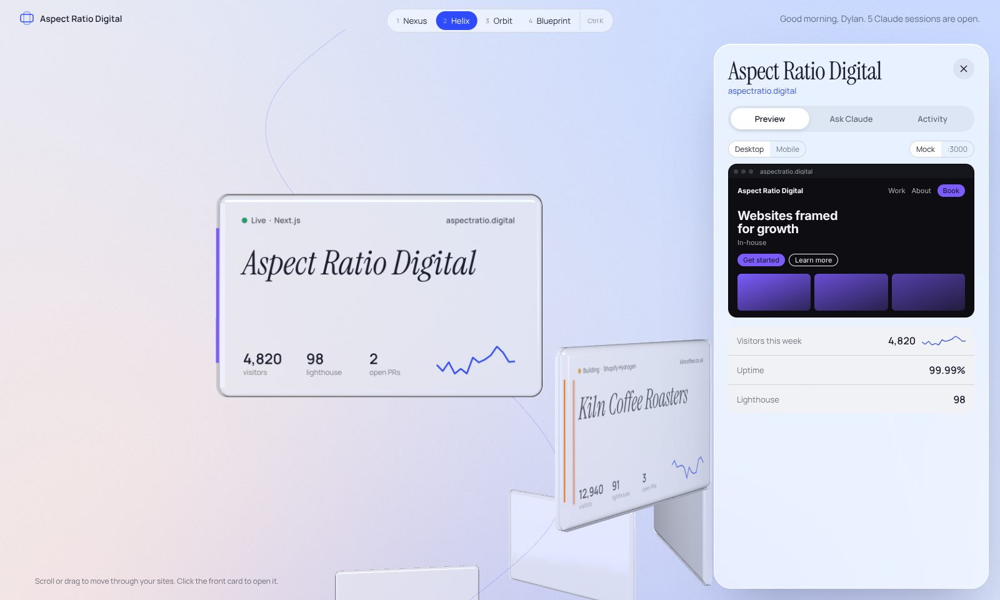
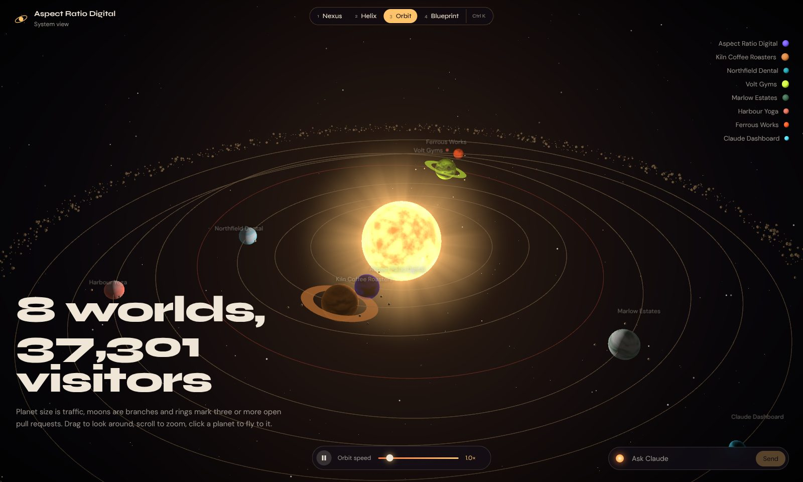
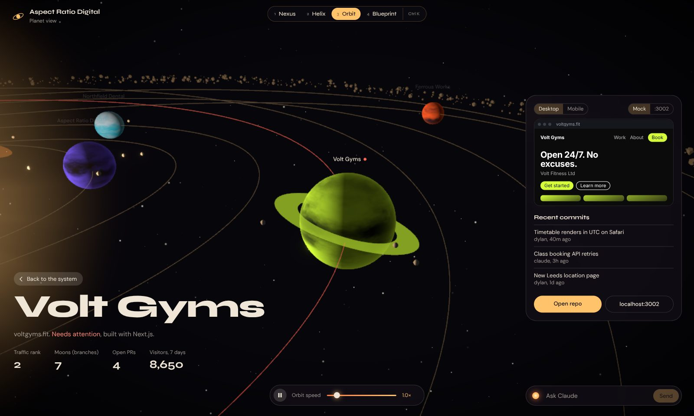
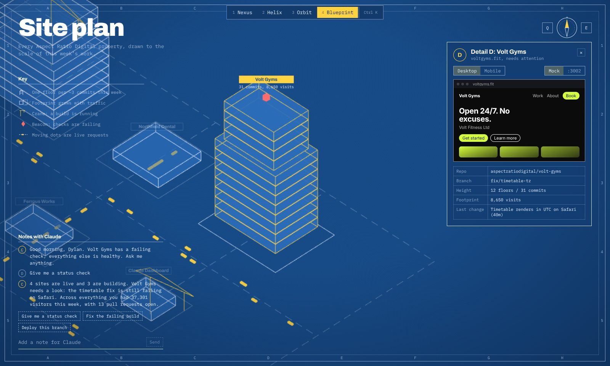

# Claude Dashboard

A desktop command centre for Aspect Ratio Digital: every client site, repo and Claude session in one 3D app that runs on your own machine.

This first version is the **3D shell**. It ships four complete dashboard concepts you can flip between live, so you can pick a direction (or mix pieces) before we wire in real data. Everything you see is driven by placeholder data in [`src/data/mock.ts`](src/data/mock.ts).


## Run it

You need [Node.js 20 or newer](https://nodejs.org) (22 LTS recommended). Works on Windows, macOS and Linux.

```bash
git clone https://github.com/aspectratiodigital/Claude-Dashboard.git
cd Claude-Dashboard
npm install

npm run app        # desktop app (Electron) with hot reload
# or
npm run dev        # same thing in your browser at http://localhost:5173
```

Other scripts:

| Command | What it does |
| --- | --- |
| `npm run app:prod` | Builds once, then opens the desktop app from the build (closest to the final experience) |
| `npm run build` | Type-checks and builds into `dist/` |
| `npm run typecheck` | Type-check only |

For the smoothest result run it on a machine with a dedicated or recent integrated GPU. Each scene watches its own frame rate and lowers render resolution if frames start to slip, then raises it again when there's headroom.

## Controls

| Key | Action |
| --- | --- |
| `1` `2` `3` `4` | Switch concept (Nexus, Helix, Orbit, Blueprint). Your choice is remembered |
| `Ctrl K` / `Cmd K` | Command palette: jump to any site or concept |
| `Esc` | Close the open site |
| `F` | Show a live frame-rate meter |

Every concept shares the same building blocks: the site list, a desktop/mobile preview of each site (mock render, or flip it to the site's `localhost` port to iframe your real dev server), recent commits, and a Claude chat that streams context-aware mock replies.

## The four concepts

### 1. Nexus: holographic HUD

The Jarvis-style one. A glowing Claude core sits at the centre with tick rings and arcs turning around it, and every site orbits as a hex node coloured by status (cyan live, amber building, red needs attention). The core pulses while Claude is talking. Hover a node or a row in the site list and a beam links it to the core; click it and the ring swings that site to the front while the right panel materialises its details and preview. Panels tilt toward your cursor, with scanlines, bloom and a slight chromatic fringe. Oxanium and Share Tech Mono.

### 2. Helix: glass spiral

Light and calm. Sites are glass slabs on a spiral that you scroll, drag or arrow through; the front card's name is set huge in Instrument Serif on the left and re-animates word by word as you move. Cards lean toward your cursor. Click the front card (or "Open workspace") and a frosted drawer slides in with Preview, Ask Claude and Activity tabs, while the helix glides aside.




### 3. Orbit: solar system

Each site is a planet around a living sun (Claude, which flares when it speaks). The data is the layout: planet size is traffic, moons are branches, rings mean three or more open PRs, and a red dot marks failing checks. Drag to look around, scroll to zoom, click a planet to fly to it and follow it along its orbit. There's an orbit speed slider and pause. Syne and DM Sans.




### 4. Blueprint: isometric site plan

Your sites drawn as a city on a drafting sheet. Each building gets a floor for roughly every three commits this week and a footprint sized by traffic; cranes swing over sites that are building and a red beacon blinks on any with failing checks. Yellow dots running along the roads are live requests. Buildings construct themselves floor by floor on load, lift and highlight on hover, and clicking one opens a "Detail" callout. Drag to pan, scroll to zoom, `Q` / `E` to rotate the plan 90°. Sheet frame, grid references and a proper title block. Archivo and IBM Plex Mono.




## How it's built

- **Electron** hosts the app ([`electron/main.cjs`](electron/main.cjs)). External links open in your normal browser.
- **Vite + React 19 + TypeScript** for the UI, with each concept code-split and preloaded in the background so switching is instant.
- **three.js via React Three Fiber** (plus drei and postprocessing) for the scenes. Custom GLSL for the Claude core, the sun, planets, stars, the helix backdrop and the drafting grid.
- **Zustand** for shared state (selected site, hover, concept). Hovering in the 2D UI highlights the 3D object and vice versa.
- 3D labels are plain DOM elements positioned from the scene each frame ([`src/shared/Labels.tsx`](src/shared/Labels.tsx)), which keeps them crisp and cheap.
- Fonts are bundled locally, so the app works offline.

```
electron/main.cjs        desktop window
src/App.tsx              concept switcher, wipe transition, hotkeys
src/data/mock.ts         placeholder sites, repos, commits, Claude sessions
src/shared/              preview frame, mock Claude, palette, labels, small charts
src/concepts/jarvis/     Nexus
src/concepts/helix/      Helix
src/concepts/orbit/      Orbit
src/concepts/blueprint/  Blueprint
```

## What's mocked, and where the real thing plugs in

| Today | Next step |
| --- | --- |
| Sites, traffic, uptime, Lighthouse in `mock.ts` | Pull from your hosting / analytics APIs |
| Repos, branches, commits, PRs in `mock.ts` | GitHub API via a token stored in the Electron main process |
| Claude replies from `src/shared/useClaude.ts` | Claude Agent SDK running in the main process, streamed to the UI over IPC (the hook already streams word by word, so the UI won't change) |
| Mock site preview | Already supports a live `localhost:<port>` iframe; add device presets and a QR code for real phones |
